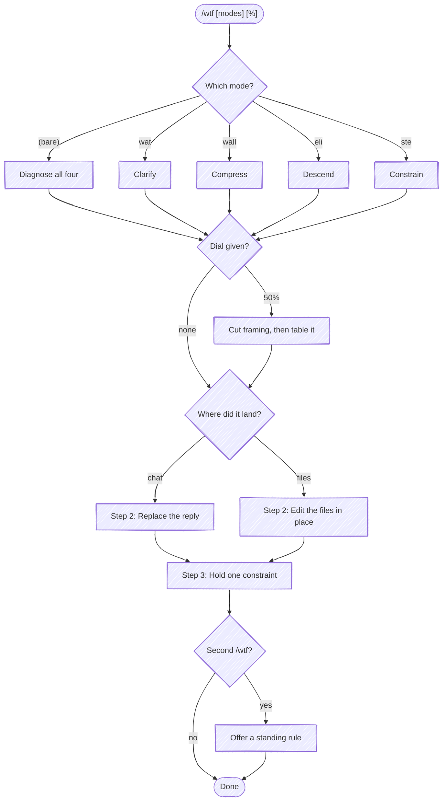

# WTF

The user could not read what you produced. Produce the readable version — that is the job, and nearly all of it.

A rewrite is a view of the reply: the same facts in the shape this reader needs, which is fathom's whole idea applied to one answer. The `eli` and `ste` modes are the same definitions a brief's framing uses, so a reader gets one meaning of "explain it plainly" whether they ask for a rewrite or a view.

This exists to unblock the task in front of them, not to adjust the harness. Carrying the correction forward is a background obligation you hold quietly, never a deliverable — making it durable costs real investment, and Step 4 is where the user opts into that.

## Before starting

**No apology, and no preamble.** Not "you're right", not "here it is, shorter". Write as though the earlier attempt never existed and this is the first answer — a do-over, not a correction. From where the user sits the earlier one conveyed nothing, so there's nothing to reference; and anything placed ahead of the answer is more text handed to someone who just told you there was too much.

**This skill is about expression, not correctness.** If the confusion is that you were *wrong* — a claim they doubt, a fix that didn't work — that's `/fathom:proof`, and translating a wrong answer into simpler words makes it worse by making it more convincing. When you genuinely can't tell which one they mean, translate first and say what you'd verify.

**Don't redo the work.** No new investigation, no new files, no re-running the tests. Same facts, different shape.

**Don't ask which mode.** A user reaching for `/wtf` has already spent the patience a clarifying question would cost. Pick and go; let them correct you if you picked wrong.

## Step 1: Pick the remedy

The argument names the defect. Each needs a different *kind* of edit — add, subtract, reorder, constrain — which is why "be clearer" isn't the answer to any of them.

**Read the section for the mode you picked before you write anything.** It carries the remedy, a worked before/after, and the specific way that remedy loses content — which you need *before* the edit, not after.

| Mode | The defect | Read |
|---|---|---|
| `wat`, `?` | Unintelligible — they can't tell what it's about | [modes.md#wat](references/modes.md#wat) |
| `wall` | Too long, and the wrong shape for the content | [modes.md#wall](references/modes.md#wall) |
| `eli` | Wrong altitude — assumed knowledge they don't have | `${CLAUDE_PLUGIN_ROOT}/kinds/base/framing/eli.md` |
| `ste` | Sentences too complex — ASD-STE100 | `${CLAUDE_PLUGIN_ROOT}/kinds/base/framing/ste.md` |

`?` is `wat` by another name, and it also covers the case where what you handed over was *questions* rather than prose. The remedy there is the same shape — stop making them do the work: make the call yourself, show the result, and carry any question you still genuinely need into a single one at the end of the turn.

**The facts survive; only the form changes.** A translation that loses content isn't a translation. The one exception is a dial that can't be honored any other way, and even there the cut gets named.

Modes combine, and remedies pull in opposite directions on volume: `eli` descending an altitude costs words, `ste` splitting sentences costs words, and a dial wants fewer. When two conflict, cut **scope** — answer fewer things, each still done right — never fidelity. Resolve it silently; a paragraph explaining how you reconciled two flags is the text they invoked this to remove.

### How far to dial it down

A percentage is an intensity dial, not a measurement. It isn't a mode either — it composes with whichever modes are named, and works alone (`/wtf 50%` means the shape was fine, the length wasn't).

| | |
|---|---|
| `25%` | Trim it. |
| `50%` | Meaningfully tighter. |
| `75%` | Strip to essentials. |

**Take the words from framing first, content last.** In order, stopping as soon as it reads tight enough:

1. **Framing, narration, and hedging.** Process description, "it's worth noting", restating the question, apologizing. Free — no content leaves.
2. **Prose carrying a list.** Converting a paragraph to a table often halves it on its own, and nothing is lost. Highest-yield edit, most commonly skipped.
3. **Detail moved off the critical path.** Demote to a sub-line, a table cell, or an offer to expand.
4. **Content.** Only when 1-3 are exhausted, and then name what left.

### Bare `/wtf`

No argument means the user didn't classify the defect — that's your job, and they've stopped wanting to help. Read [modes.md](references/modes.md) and both framing rules whole rather than one section, diagnose against all four, and fix each defect you find. Then cut hardest, because a frustrated reader is the least willing to read: lead with the single sentence that answers them.

## Step 2: Deliver it where the problem is

Check what the previous turn produced, because the reply and the artifacts fail separately.

**Chat only** — post the translation *as* the reply. Replace, don't append: leaving the original above it doubles the reading. No "here's what I said before" recap.

**Files written or edited** — the prose in the file is the defect, so edit the file. A readable chat summary of an unreadable README fixes nothing. Then name the paths, and don't paste the rewritten file into chat.

**Both** — do both. Same defect, both surfaces.

## What you send back

**The rewrite is the reply.** Not a rewrite plus a report about the rewrite. Every line you add explaining the edit is a line they have to read, in answer to a complaint about having to read too much — so the accounting instinct here is precisely inverted.

At most one short line may follow the artifact, and only to name content that had to be dropped. Nothing else — including the constraint from Step 3, which you hold rather than declare. Specifically, none of these:

| Don't send | Why |
|---|---|
| `356 → 191 words, a 46% cut` | The dial isn't a measurement, and counting isn't the task. |
| `Where the words went: the thank-you, the method narration, …` | An inventory of edits is a second document about the first. |
| `Kept verbatim: your sentence about X` | What didn't change isn't news. |
| `I stopped at 46% rather than 50%` | The dial is not a contract, so there's no shortfall to negotiate. |
| `One tension worth naming: ste wants one idea per sentence, but…` | You resolved it. That's the whole job. |
| `Standing constraint, still the one from earlier plus this: …` | The constraint is held, never declared — and an accumulating list of them least of all. |

Naming dropped *content* is the exception, and it's the opposite of the rows above: "cut the CI-config detail; say the word" points at a fact that left, which they'd otherwise never know was gone.

## Step 3: Hold one constraint, silently

Pick a single concrete rule to carry for the rest of the session. Concrete means checkable by reading a later reply — which is also the only evidence that counts, so **don't announce it.** A declared pledge is preamble wearing a different hat, and it asks the user to take on faith what the next reply will demonstrate anyway.

| Too vague to hold | Checkable |
|---|---|
| "I'll be clearer." | "Answers lead with the conclusion; the reasoning goes below it, or nowhere." |
| "I'll keep it shorter." | "Anything with per-item attributes goes in a table, not a paragraph." |
| "I'll simplify." | "First use of a term I introduce gets a five-word gloss." |
| "I'll watch the length." | "No status narration — you get what changed and what's left, not what I did." |

If bare mode turned up several defects, pick the one likely to recur — a shape habit (`wall`, `eli`) over a one-off mechanical slip.

Hold it on every surface prose reaches: replies, files, commit messages, and the leak most often missed, tool-result summaries. "Here's what the test output said" is prose the user reads.

## Step 4: When it's the second `/wtf`

A second invocation in one session means the per-session fix isn't holding, and repeating it louder won't change that. Say so, and offer to make it durable: write the constraint down where every future session loads it (the user's own instructions, or the project's `AGENTS.md`), or into their rules system when they have one.

Offer it in one sentence and let them decline. Don't write the rule unprompted — a rule the user didn't ask for is a permanent cost paid for a transient annoyance.
